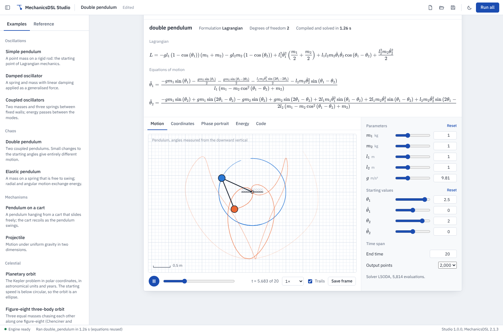

# MechanicsDSL Studio

A desktop worksheet for [MechanicsDSL](https://github.com/MechanicsDSL). Write a system's
Lagrangian or Hamiltonian, and the worksheet shows its equations of motion, an animation,
plots of the motion and its energy, and standalone simulation code in twelve languages.



## What it does

- **Equations of motion, typeset.** The Lagrangian (or Hamiltonian) and the derived
  equations are shown as they would appear in a textbook, and can be copied as LaTeX.
- **Animation without setup.** Pendulum chains, elastic pendulums, carts, orbits,
  particles in a plane and masses on springs are recognised from their coordinates and
  drawn as a mechanical drawing on graph paper, with trails, scrubbing and playback speed.
- **Live parameters.** Every parameter and starting value has a slider. The equations are
  derived once and reused, so a change re-solves in a fraction of a second.
- **Plots.** Each coordinate against time, phase portraits, and the energy function with
  its relative drift, which measures the solver's accuracy for a conservative system.
- **Code generation.** C++, Python, Rust, Julia, MATLAB, Fortran, JavaScript, C++ with
  OpenMP, CUDA, WebAssembly, Arduino and bare-metal ARM Cortex-M C, generated from the same
  equations and saved to a folder.
- **Worksheets.** Systems and notes (with `$…$` mathematics) in one document, saved as
  `.mdsw` files. Nine worked examples and a command reference are built in.
- **Works offline.** Computation runs in a separate process, so the window stays
  responsive and a long run can be stopped.

## Download

Windows 10 or 11 (64-bit): download `MechanicsDSL-Studio-1.0.0-windows.zip` from the
[latest release](../../releases/latest), extract it, and run `MechanicsDSL Studio.exe`
inside the extracted folder. No installation is needed. The window uses Microsoft Edge
WebView2, which is part of Windows 11 and current Windows 10.

## Writing a system

```latex
\system{simple_pendulum}
\defvar{theta}{Angle from vertical}{rad}
\parameter{m}{1.0}{kg}
\parameter{l}{1.0}{m}
\parameter{g}{9.81}{m/s^2}
\lagrangian{\frac{1}{2}*m*l^2*\dot{theta}^2 - m*g*l*(1-\cos{theta})}
\initial{theta=0.5, theta_dot=0}
```

The Reference tab lists every command. Angles in a pendulum chain are measured from the
downward vertical, with lengths named `l1`, `l2`, … (or `l`).

| Shortcut | Action |
|---|---|
| Shift+Enter | Run the system and move to the next |
| Ctrl+Enter | Run the system |
| Ctrl+Shift+Enter | Run every system in the worksheet |
| Ctrl+S, Ctrl+Shift+S | Save, save as |
| Ctrl+O, Ctrl+N | Open, new worksheet |
| Esc | Stop a running computation |

## Running from source

Python 3.10 to 3.13.

```
pip install -r requirements.txt
python -m mechanicsdsl_studio.app
```

For working on the interface in an ordinary browser:
`python -m mechanicsdsl_studio.devserver` and open http://127.0.0.1:8765.

## Tests

```
pip install pytest
python -m pytest -q tests
```

The tests run every example, check energy conservation and a pendulum's period against
the closed form, cover Hamiltonian systems, syntax errors and all twelve code generators,
and check that a running computation can be stopped.

## Building the Windows application

```
build_exe.bat
```

The script creates a separate build environment (`.buildenv`), runs the tests, builds
`dist\MechanicsDSL Studio\` with PyInstaller, runs the finished program's self-test
(`"MechanicsDSL Studio.exe" --selftest report.txt`), and zips the folder for release.

## How it is built

- `mechanicsdsl_studio/engine.py`: compiles, simulates, typesets and generates code,
  returning plain JSON. Compiled systems are cached by source.
- `mechanicsdsl_studio/worker.py`: runs the engine in a child process that can be stopped.
- `mechanicsdsl_studio/geometry.py`: works out how to draw a system from its coordinates.
- `mechanicsdsl_studio/app.py`: the window (pywebview) and file handling.
- `mechanicsdsl_studio/web/`: the interface, with KaTeX, CodeMirror, plotly.js and the
  IBM Plex typefaces bundled for offline use.

## Licence

MIT; see [LICENSE](LICENSE). Bundled third-party components are listed in
[THIRD_PARTY_NOTICES.md](THIRD_PARTY_NOTICES.md).
